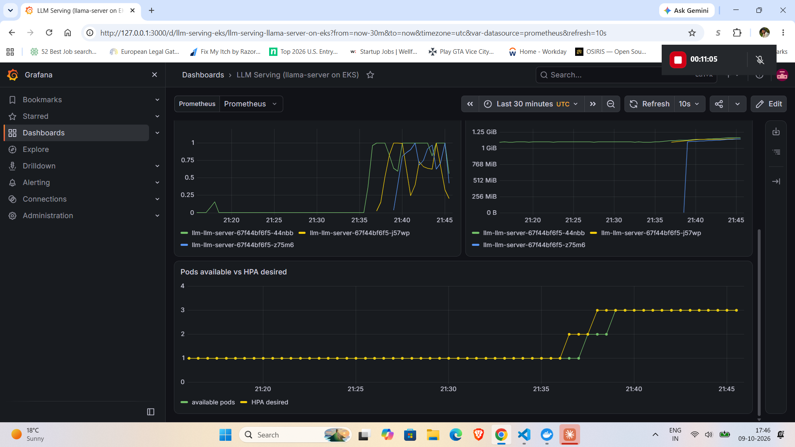
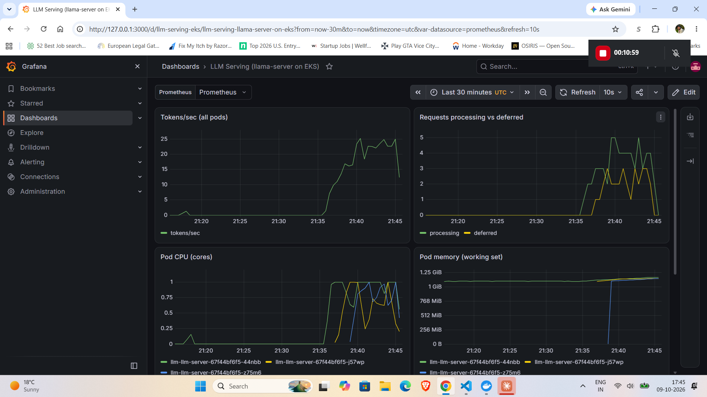
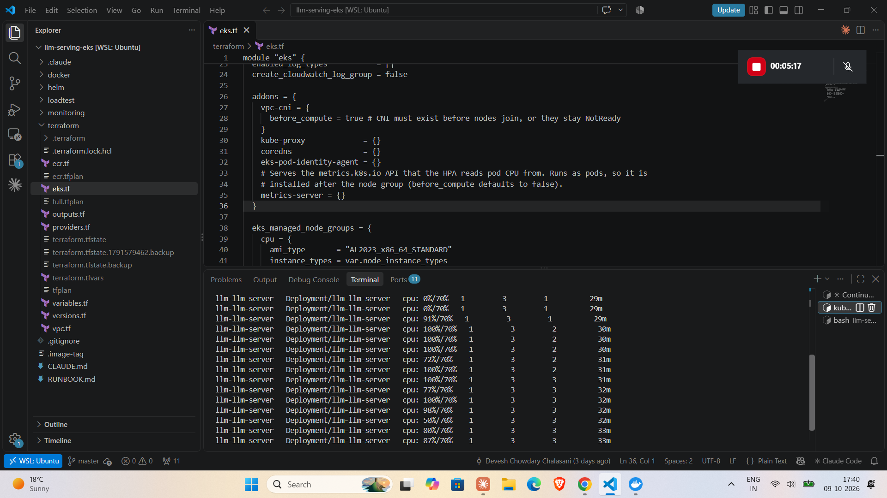
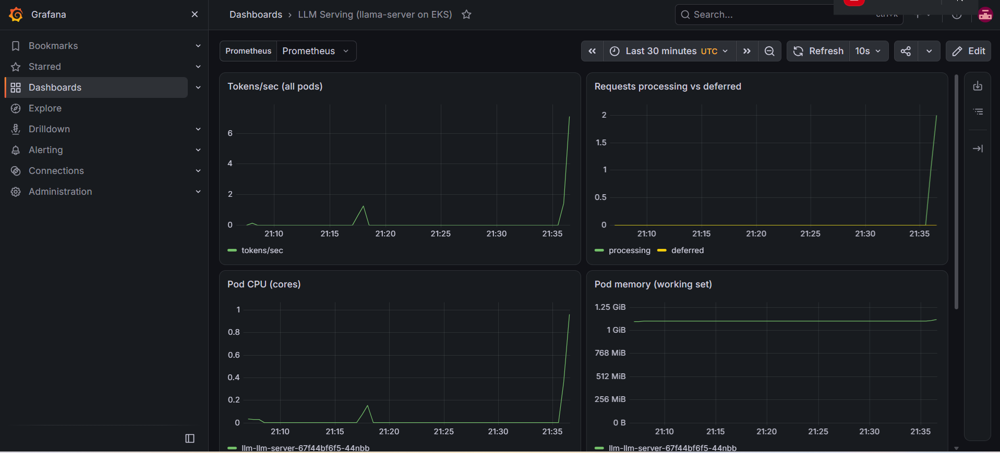

# LLM Serving on AWS EKS

Open-source LLM served on Kubernetes with autoscaling and observability, provisioned entirely with Terraform and Helm.

A llama.cpp server running Qwen2.5-1.5B-Instruct (Q4_K_M) on AWS EKS. A Horizontal Pod Autoscaler scales it from 1 to 3 pods under load, while Prometheus and Grafana track tokens/sec, request queueing, pod count, CPU, and memory.

## Result

A 10-minute k6 ramp (up to 6 concurrent users) against the in-cluster Service:

| Metric | Measured |
|---|---|
| Requests | 202 total, **0 failed** (100% HTTP 200) |
| Autoscaling | HPA scaled **1 → 2 → 3 pods**, about a minute apart, each pod on a different node |
| Peak cluster throughput | **29.4 tokens/sec** (1-minute rate, summed across pods) |
| Peak deferred requests | 3 (requests queued while new pods started) |
| Latency | median 12.63s, **p95 25.13s**, max 35.05s |
| Per-request generation speed | avg 5.83 tok/s, p95 7.96 tok/s |
| Total completion tokens | 10,935 |

Raw outputs are in [`evidence/20261009/`](evidence/20261009/): k6 summary, HPA describe, pod placement, and Prometheus peak queries.

**About the CPU:** `m7i-flex` instances run at a 40% CPU baseline and can burst to full CPU most of the time, so throughput on other instance families will differ.

**About the latency:** this is CPU-only inference of a 1.5B model on 2 vCPU nodes, so single-request latency is high by design. The goal of the project is the serving platform (scaling, queue behaviour, observability), not model speed. GPU nodes are the obvious next step for latency.

### Screenshots

HPA desired vs available pods stepping 1 → 2 → 3:


Tokens/sec, processing vs deferred requests, and per-pod CPU/memory:


`kubectl get hpa -w` during the ramp (CPU above the 70% target, replicas 1 → 3):


Baseline as load starts (1 pod):


## Architecture

```
k6 Job (in-cluster, ramp to 6 VUs)
        |
Service llm-llm-server (ClusterIP :8080)
        |
Pods: llama.cpp llama-server + Qwen2.5-1.5B Q4_K_M (CPU)   <-- HPA: CPU 70% of request, 1 to 3 pods
  one pod per m7i-flex.large node, 3 nodes, 2 AZs
        |  /metrics (ServiceMonitor, every 15s)
Prometheus (kube-prometheus-stack)  -->  Grafana dashboard
        ^
metrics-server (pod CPU for the HPA)

Terraform: VPC (public subnets, no NAT), EKS, managed node group, ECR
```

- **Cloud:** AWS EKS (Kubernetes 1.36), region us-east-2
- **Network:** VPC across 2 AZs, public subnets only, no NAT gateway (cost)
- **Nodes:** managed node group, 3x `m7i-flex.large` (2 vCPU / 8 GiB), AL2023
- **Model server:** llama.cpp `llama-server` with `--metrics`, Qwen2.5-1.5B-Instruct Q4_K_M GGUF (about 1.1 GB) baked into the image, pinned base image digest and verified model checksum
- **Container:** non-root (UID 65532), read-only root filesystem
- **Registry:** Amazon ECR, immutable tags, lifecycle policy keeps last 5
- **Autoscaling:** HPA, min 1 / max 3, target 70% CPU of a 1000m request
- **Observability:** kube-prometheus-stack (Prometheus + Grafana) with a ServiceMonitor scraping `/metrics` every 15s
- **Load test:** k6 as an in-cluster Job with `noConnectionReuse` so kube-proxy balances per request and new pods actually receive traffic
- **IaC:** Terraform using `terraform-aws-modules/vpc` and `eks`; Helm chart in `helm/llm-server/`
- **CI:** not yet added (planned: GitHub Actions for image build and `terraform plan`; apply stays manual)

### Pod sizing

Requests 1000m CPU / 2Gi RAM, limits 2000m / 3Gi, which fits one pod per node. The server runs `--parallel 2 --ctx-size 4096`, so each pod handles 2 concurrent requests. With 6 virtual users the first pod queues requests, CPU crosses the HPA threshold, and the autoscaler adds pods.

## Repository layout

```
terraform/   VPC, EKS, ECR
docker/      Dockerfile for llama-server + model
helm/        llm-server chart (Deployment, Service, HPA, ServiceMonitor)
monitoring/  kube-prometheus-stack values, Grafana dashboard JSON
loadtest/    k6 ramp Job
evidence/    measured outputs from the test run
docs/images/ screenshots
RUNBOOK.md   exact command sequence for a paid session
```

## Run it

Everything is in [`RUNBOOK.md`](RUNBOOK.md). In short: `terraform apply` (ECR first, push image, then the cluster), install kube-prometheus-stack, install the Helm chart with the image tag, import the dashboard, apply the k6 Job, then `helm uninstall` both releases and `terraform destroy`.

The stack costs roughly $0.45/hour while running and was destroyed after the test. All 46 resources were removed and verified empty.

## Lessons learned

1. **Free plan blocked `m5.large`.** The node group sat in CREATING with no EC2 instances, and `terraform apply` hung for over 30 minutes. CloudTrail `RunInstances` showed `InvalidParameterCombination: The specified instance type is not eligible for Free Tier`. Recovery: Ctrl-C the apply, `aws eks delete-nodegroup`, `terraform state rm` the node group, re-plan. Switched to `m7i-flex.large` (same 2 vCPU / 8 GiB, Free Tier eligible); the new node group was ACTIVE in 76 seconds.
2. **`ADD --chmod=444` on a directory** dropped the execute bit on `/models`, making the model unreadable. Fixed with `RUN mkdir -p -m 755 /models` before the `ADD`.
3. **Docker in WSL2, two separate failures.**
   - Socket permission denied: user was not in the `docker` group. Fixed with `sudo usermod -aG docker $USER` and a WSL restart.
   - `Cannot connect to the Docker daemon at unix:///var/run/docker.sock`: Docker Desktop (which serves the socket through WSL integration) wasn't running. Fixed by starting Docker Desktop, confirming WSL integration for Ubuntu, and re-checking with `docker info`.
4. **curl globbing on PromQL.** Curly braces in the query URL were treated as curl globs. Fixed with `--get --data-urlencode`.
5. **HPA metric warnings at install.** `FailedGetResourceMetric` events appeared until metrics-server had data for the new pod. Expected at install time and unrelated to the load test.

## Built with

Terraform, Helm, Kubernetes, AWS EKS, Docker, llama.cpp, Prometheus, Grafana, k6. Developed with Claude Code assistance.
